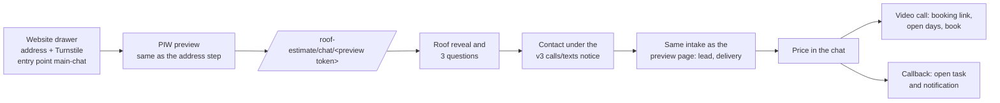

# Quote chat (phase 1)

The main site's quote drawer can open as a guided chat: it asks for the
address, shows the roof, asks three quick questions, unlocks the price, and
then books a video consultation or takes a callback request, all in one
conversation. Phase 1 has no AI. Every message is fixed copy, every answer is
a tap or a form field, and every step calls an endpoint PIW already had (or a
thin JSON version of one).

## How it fits together



- **The hop.** The website asks the first question and creates the preview,
  exactly as the drawer's address step does today, so Turnstile, the website's
  consent token and attribution travel the same way. PIW returns
  `/roof-estimate/chat/<token>` instead of `/roof-estimate/p/<token>` for
  `main-chat` previews, and the browser continues there. The chat page replays
  the address question so it reads as one conversation. Embedding PIW in an
  iframe was rejected earlier for autocomplete, consent and mobile keyboard
  reasons; that still applies.
- **Consent.** The property notice is accepted at the address step on the
  website, unchanged. The contact form in the chat shows the same notice as
  the preview page (`all-season-campaign-estimate-v3`), naming the same
  button, "Unlock my price". Conversion goes through the same convert route
  and intake, so lead delivery, Meta and estimate texts and emails behave as
  they do for the preview page.
- **The price.** After conversion the chat exchanges the continuation for the
  estimate token as JSON (`POST /api/roof-estimate/continue`), which sets the
  same session and consent cookies as following the redirect would. It then
  polls `GET /api/roof-estimate/<estimate>/summary`, which uses the estimate
  page's own rules (`quietEstimateState`), so the two never disagree. If
  another browser already opened the estimate, the chat says the price is on
  its way by text and email.
- **Booking.** `POST /api/roof-estimate/<estimate>/booking-link` now works for
  any estimate with a lead, not only finished assessments, and returns the
  link token. The chat reads `GET /api/booking/<link>/overview` (the booking
  page's model, without the Google lookup once booked) and books with the
  existing `POST /api/booking/<link>`. Changes and cancellations happen on the
  existing manage page, linked from the chat.
- **Callback.** `POST /api/roof-estimate/<estimate>/callback` with a window
  (`asap`, `morning`, `afternoon`, `evening`) calls
  `request_estimate_callback`, which opens one task per lead
  (`tasks.origin = 'callback_request'`), due when the window next opens in
  Eastern time, plus a `callback_requested` notification. Asking again updates
  the same task. Staff see it on the home page, the pipeline and the lead.

## Configuration

| Where | Variable | Purpose |
| --- | --- | --- |
| PIW | `QUOTE_CHAT_ENABLED` | Sends `main-chat` previews to the chat page. Needs `PROPERTY_PREVIEW_ENABLED`. Off: chat starts open the classic preview page. |
| Website | `NEXT_PUBLIC_QUOTE_CHAT_ENABLED` | Opens the drawer as a chat. Needs `NEXT_PUBLIC_PROPERTY_PREVIEW_ENABLED` and a Turnstile site key. |
| PIW | Booking (see [virtual-consultation-booking.md](virtual-consultation-booking.md)) | Without booking on and configured, the chat offers a callback instead of times. |

## Rollout

1. Apply `20261019180000_quote_chat_callbacks.sql`. It is additive: a nullable
   column on `tasks`, a partial unique index, a notification type and one
   function.
2. Deploy PIW and the website with both flags off. Nothing changes.
3. Turn on `QUOTE_CHAT_ENABLED` in PIW production. Still nothing changes for
   visitors, because the website does not send `main-chat` yet.
4. In a website preview deployment, turn on `NEXT_PUBLIC_QUOTE_CHAT_ENABLED`
   and run one internal conversation end to end: address, answers, contact,
   price, book a time, then cancel it from "Change or cancel". Run a second
   one that asks for a callback, and check the task and notification on the
   lead.
5. Turn on `NEXT_PUBLIC_QUOTE_CHAT_ENABLED` in website production.

Rollback, fastest first: turn off the website flag (the drawer goes back to the
address step), or turn off the PIW flag (chat starts land on the classic
preview page). Leads, bookings and callback tasks already created stay.

For a local walkthrough with stubbed data, run `npm run dev` and open
`/roof-estimate/dev-preview?screen=chat`.

## Measuring it

Previews record their entry point, so the chat and the drawer compare directly.
At current traffic this is a judgment call from the first conversations, not
a statistical test.

```sql
with previews as (
  select preview.entry_point, preview.revealed_at, preview.contact_viewed_at, preview.converted_lead_id
  from public.property_previews preview
  where preview.entry_point in ('main-chat', 'main-drawer')
    and preview.created_at > now() - interval '30 days'
)
select
  previews.entry_point,
  count(*) as addresses,
  count(previews.revealed_at) as roofs_shown,
  count(previews.contact_viewed_at) as reached_contact,
  count(previews.converted_lead_id) as leads,
  count(distinct appointment.lead_id) as video_calls_booked,
  count(distinct task.lead_id) as callbacks_requested
from previews
left join public.appointments appointment
  on appointment.lead_id = previews.converted_lead_id
  and appointment.booking_source = 'self_service'
left join public.tasks task
  on task.lead_id = previews.converted_lead_id
  and task.origin = 'callback_request'
group by previews.entry_point
order by previews.entry_point;
```

The website also tags its `quote_form_view` event with `mode: chat` or
`mode: form`, for drawer opens.

## Limits and failure modes

| Situation | Behavior |
| --- | --- |
| Roof measurement still running | The roof card says "Measuring your roof…" and updates in place; the questions don't wait for it. |
| Price still pricing after about two minutes | The chat says it will arrive by text and email, then still offers a call. |
| Low-confidence measurement or no instant range | No price; the chat explains and offers a video call as the way to a firm number. |
| Booking off, paused, or no open times | The chat offers a callback instead. |
| Slot taken between picking and booking | "That time was just taken" and fresh days. |
| Preview expired | The chat offers "Start again" at the address step. |
| Homeowner reloads after giving contact details | Same tab: the chat picks up at the price (session storage). Elsewhere: the price is on its way by text and email. |
| Privacy banner not yet answered | Extra space below the controls so they scroll clear of it. |

Not in phase 1: typed answers or free-form questions (phase 2, with an
approved FAQ list), rescheduling inside the chat (it links to the manage page),
texts from the chat (pending SMS consent ownership), Spanish, and in-person
inspections.
