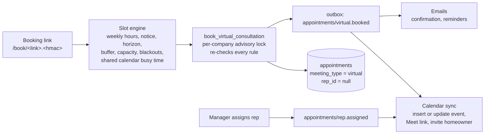

# Virtual consultation booking

Homeowners book a video consultation themselves from a signed, per-lead link.
The booking lands unassigned; a manager gives it to a rep from
**Consultations**. Google Calendar holds the event and the Meet link, and PIW
stays the source of truth.

## How it fits together



- **Where links come from.** Staff press *Get booking link* on a lead. The
  estimate result page offers *Pick a video call time* when booking is on.
  A lead has one live link at a time; it lasts 30 days, is reused while it has
  a week left, and stays valid until two days after a booked meeting so the
  homeowner can reschedule or cancel from it.
- **Who decides availability.** The page proposes times, but
  `book_virtual_consultation` and `reschedule_virtual_consultation` re-check
  every rule inside a transaction that holds a per-company advisory lock, so
  two homeowners cannot take the last seat in a slot.
- **What blocks time.** PIW consultations count against *Meetings at the same
  time*. Anything else on the shared Google calendar (not created by PIW)
  blocks the whole team for that time, with the buffer applied. *Days off* in
  Settings block whole days.
- **What the homeowner sees.** First name, the masked invite email, times in
  Eastern, and their own booking. The page never shows phone, address, or the
  full email. Responses are `no-store` and the page sends no Referer.

## One-time Google setup (keyless, recommended)

PIW authenticates to Google with Vercel's per-request OIDC token through
Workload Identity Federation, then asks Google to sign the domain-wide
delegation JWT. No service account key exists, so nothing can leak or needs
rotating, and organizations that enforce
`iam.managed.disableServiceAccountKeyCreation` (Google's secure-by-default
policy) need no exception.

Use a small Cloud project that holds nothing else. Replace `PROJECT_ID`,
`PROJECT_NUMBER`, `TEAM_SLUG` (from the Vercel team URL) and `VERCEL_PROJECT`
(the Vercel project name, `piw`).

1. **Enable the APIs.**
   ```bash
   gcloud services enable calendar-json.googleapis.com iamcredentials.googleapis.com \
     sts.googleapis.com iam.googleapis.com --project PROJECT_ID
   ```
2. **Create the service account.** It needs no project roles.
   ```bash
   gcloud iam service-accounts create piw-booking --display-name "PIW booking" --project PROJECT_ID
   ```
3. **Trust Vercel.** In the Vercel project's security settings, confirm OIDC
   federation is on with the **Team** issuer mode. Then:
   ```bash
   gcloud iam workload-identity-pools create vercel --location global --project PROJECT_ID
   gcloud iam workload-identity-pools providers create-oidc vercel \
     --location global --workload-identity-pool vercel --project PROJECT_ID \
     --issuer-uri "https://oidc.vercel.com/TEAM_SLUG" \
     --allowed-audiences "https://vercel.com/TEAM_SLUG" \
     --attribute-mapping "google.subject=assertion.sub"
   ```
4. **Let only PIW production sign as the service account.** This is the one
   role in the setup.
   ```bash
   gcloud iam service-accounts add-iam-policy-binding \
     piw-booking@PROJECT_ID.iam.gserviceaccount.com --project PROJECT_ID \
     --role roles/iam.serviceAccountTokenCreator \
     --member "principal://iam.googleapis.com/projects/PROJECT_NUMBER/locations/global/workloadIdentityPools/vercel/subject/owner:TEAM_SLUG:project:VERCEL_PROJECT:environment:production"
   ```
   To test in previews, add a second binding ending in `environment:preview`.
5. **Domain-wide delegation.** Get the service account's client ID:
   ```bash
   gcloud iam service-accounts describe piw-booking@PROJECT_ID.iam.gserviceaccount.com \
     --project PROJECT_ID --format 'value(oauth2ClientId)'
   ```
   In the Google Workspace admin console (*Security, Access and data control,
   API controls, Domain-wide delegation*), add that client ID with exactly
   `https://www.googleapis.com/auth/calendar.events`.
6. **Delegated user and calendar.** Pick the Workspace user PIW acts as (for
   example `scheduling@<domain>`, not a person). Create a calendar named
   **Virtual consultations** owned by or shared with that user with *Make
   changes to events*, and copy its calendar ID from the calendar's settings.
7. **Meet.** Make sure Google Meet is enabled for that user's organizational
   unit. Without it, events are created with no Meet link and the page tells
   the homeowner the link will arrive in the invite.

### Fallback: service account key

If an organization allows keys, skip steps 3 and 4, create a JSON key for the
service account, and set `GOOGLE_CALENDAR_SERVICE_ACCOUNT_JSON` instead of
the two keyless variables. When both are set, keyless wins.

### Reading auth failures

| Logged error | Usual cause |
| --- | --- |
| `Google workload identity exchange failed with 400` | Issuer or audience in step 3 does not match the Vercel team, or OIDC federation is off. |
| `Google signJwt failed with 403` | The Token Creator binding in step 4 is missing, or the deployment is not the environment it names. |
| `Google token exchange failed with 401` | Domain-wide delegation in step 5 is missing, or the scope differs. |
| `Google Calendar ... failed with 404` | The delegated user cannot see the calendar ID in Settings. |

## Configuration

| Variable | Purpose |
| --- | --- |
| `VIRTUAL_BOOKING_ENABLED` | Master switch. When `false`, booking pages and APIs return 404. |
| `BOOKING_LINK_SIGNING_SECRET` | 32+ bytes. Signs links. Rotating it invalidates every outstanding link. |
| `GOOGLE_CALENDAR_SERVICE_ACCOUNT_EMAIL` | Keyless: `piw-booking@PROJECT_ID.iam.gserviceaccount.com`. |
| `GOOGLE_WORKLOAD_IDENTITY_PROVIDER` | Keyless: `projects/PROJECT_NUMBER/locations/global/workloadIdentityPools/vercel/providers/vercel`. Set both keyless variables or neither. |
| `GOOGLE_CALENDAR_SERVICE_ACCOUNT_JSON` | Fallback only: the key file, on one line. A malformed value switches booking off and logs `booking_configuration_invalid`. |
| `GOOGLE_CALENDAR_DELEGATED_USER` | The Workspace user from step 6. |

Running locally with keyless auth: `vercel env pull` writes a
`VERCEL_OIDC_TOKEN` that PIW uses outside Vercel. It expires after a few
hours, so pull again when calls start failing with the 400 above.
| `BOOKING_FROM_EMAIL` | Resend-verified sender for confirmations and reminders. Without it (or `RESEND_API_KEY`), Google invites still go out but PIW emails are skipped. |

Then, as a company admin, open **Settings → Video booking**: paste the calendar
ID, set weekly hours, length, gap, notice, how many meetings can run at once,
the support phone, and add the reps who take consultations (with emails, so
they are added to the invite). Turn booking on and save.

## Rollout

1. Apply the migration. It is additive: existing appointments keep
   `meeting_type = null` and behave exactly as before.
2. Deploy with `VIRTUAL_BOOKING_ENABLED=false`. Smoke the staff pages.
3. In a preview deployment, set the variables, configure a test calendar, and
   book, move, and cancel against a test lead. Confirm the event, Meet link,
   invite, and emails each time.
4. Enable in production. Send one booking link to an internal lead before
   offering it to homeowners.

Rollback: set `VIRTUAL_BOOKING_ENABLED=false`. Existing consultations stay in
PIW and on the calendar; links stop working until it is turned back on.

## Operating it

- **Needs a rep.** New bookings show in **Consultations** and in the sidebar
  count. Assigning a rep adds them to the Google invite (homeowners get an
  updated invite naming the rep) and queues the rep intro.
- **Calendar failed.** The badge carries the Google error. Common causes: the
  delegation scope is missing, the delegated user lost access to the calendar,
  or Meet is off for that user. Fix the cause, then press **Retry**.
- **Outcomes.** After the meeting time passes, mark it **Held** or
  **No-show**. That is the post-sit signal for reporting.
- **Moving a consultation for the homeowner.** Send them their booking link
  (the lead's *Get booking link* returns the same one) or cancel and ask them
  to rebook. Direct edits to a virtual consultation's time are refused by the
  database because they would leave the calendar wrong.

## Limits and failure modes

| Situation | Behavior |
| --- | --- |
| Google Calendar unreachable while listing times | Page fails closed: "Online booking is paused right now", with the support phone. |
| Google fails after a booking commits | The booking stands and shows *Calendar failed*. The sync retries up to four more times and a later success clears it; after that a manager can press **Retry**. The confirmation email still goes out. |
| Two homeowners pick the last seat | The second gets "That time was just taken" and fresh times. |
| Abuse | Ten changes per link and thirty per IP address per hour. Five reschedules per consultation. |
| Duplicate event delivery | The sync is state-based and the Google event ID is derived from the appointment, so retries update rather than duplicate. Emails use Resend idempotency keys per appointment, kind, and revision. |
| Reminder for a moved or cancelled meeting | Reminders are pinned to the revision that scheduled them and are skipped if it changed. |

Not in v1: SMS confirmations (pending SMS consent ownership), an anonymous
public booking page (it would duplicate the intake, consent and bot checks on
`/roof-estimate`), and writing appointments into LeadMaster.
