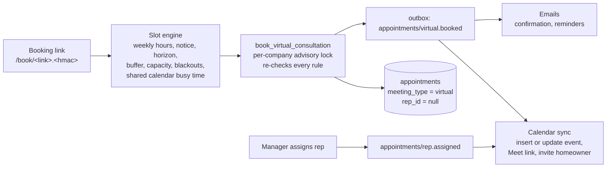

# Virtual consultation booking

Homeowners book a video consultation themselves from a signed, per-lead link.
The booking lands unassigned; a manager gives it to a rep from
**Consultations**. Google Calendar holds the event and the Meet link, and PIW
stays the source of truth.

## How it fits together

- **Where links come from.** Staff press *Get booking link* on a lead. The
  estimate result page offers *Pick a video call time* when booking is on.
  A lead has one live link at a time; it lasts 30 days, is reused while it has
  a week left, and stays valid until two days after a booked meeting so the
  homeowner can reschedule or cancel from it.
- **Who decides availability.** The page proposes times, but
  `book_virtual_consultation` and `reschedule_virtual_consultation` re-check
  every rule inside a transaction that holds a per-company advisory lock, so
  two homeowners cannot take the last seat in a slot.
- **What blocks time.** PIW consultations count against *Meetings at the same
  time*. Anything else on the shared Google calendar (not created by PIW)
  blocks the whole team for that time, with the buffer applied. *Days off* in
  Settings block whole days.
- **What the homeowner sees.** First name, the masked invite email, times in
  Eastern, and their own booking. The page never shows phone, address, or the
  full email. Responses are `no-store` and the page sends no Referer.

## One-time Google Workspace setup

1. In Google Cloud (any project the company controls), create a service
   account and a JSON key. Enable the **Google Calendar API**.
2. In the Google Workspace admin console: *Security → Access and data control
   → API controls → Domain-wide delegation*. Add the service account's client
   ID with exactly this scope:
   `https://www.googleapis.com/auth/calendar.events`
3. Pick the Workspace user PIW acts as (for example `scheduling@<domain>`).
   Create a calendar named **Virtual consultations** owned by or shared with
   that user with *Make changes to events*. Copy its calendar ID from the
   calendar's settings.
4. Make sure Google Meet is enabled for that user's organizational unit.
   Without it, events are created with no Meet link and the page tells the
   homeowner the link will arrive in the invite.

## Configuration

| Variable | Purpose |
| --- | --- |
| `VIRTUAL_BOOKING_ENABLED` | Master switch. When `false`, booking pages and APIs return 404. |
| `BOOKING_LINK_SIGNING_SECRET` | 32+ bytes. Signs links. Rotating it invalidates every outstanding link. |
| `GOOGLE_CALENDAR_SERVICE_ACCOUNT_JSON` | The key file, on one line. A malformed value switches booking off and logs `booking_configuration_invalid`. |
| `GOOGLE_CALENDAR_DELEGATED_USER` | The Workspace user from step 3. |
| `BOOKING_FROM_EMAIL` | Resend-verified sender for confirmations and reminders. Without it (or `RESEND_API_KEY`), Google invites still go out but PIW emails are skipped. |

Then, as a company admin, open **Settings → Video booking**: paste the calendar
ID, set weekly hours, length, gap, notice, how many meetings can run at once,
the support phone, and add the reps who take consultations (with emails, so
they are added to the invite). Turn booking on and save.

## Rollout

1. Apply the migration. It is additive: existing appointments keep
   `meeting_type = null` and behave exactly as before.
2. Deploy with `VIRTUAL_BOOKING_ENABLED=false`. Smoke the staff pages.
3. In a preview deployment, set the variables, configure a test calendar, and
   book, move, and cancel against a test lead. Confirm the event, Meet link,
   invite, and emails each time.
4. Enable in production. Send one booking link to an internal lead before
   offering it to homeowners.

Rollback: set `VIRTUAL_BOOKING_ENABLED=false`. Existing consultations stay in
PIW and on the calendar; links stop working until it is turned back on.

## Operating it

- **Needs a rep.** New bookings show in **Consultations** and in the sidebar
  count. Assigning a rep adds them to the Google invite (homeowners get an
  updated invite naming the rep) and queues the rep intro.
- **Calendar failed.** The badge carries the Google error. Common causes: the
  delegation scope is missing, the delegated user lost access to the calendar,
  or Meet is off for that user. Fix the cause, then press **Retry**.
- **Outcomes.** After the meeting time passes, mark it **Held** or
  **No-show**. That is the post-sit signal for reporting.
- **Moving a consultation for the homeowner.** Send them their booking link
  (the lead's *Get booking link* returns the same one) or cancel and ask them
  to rebook. Direct edits to a virtual consultation's time are refused by the
  database because they would leave the calendar wrong.

## Limits and failure modes

| Situation | Behavior |
| --- | --- |
| Google Calendar unreachable while listing times | Page fails closed: "Online booking is paused right now", with the support phone. |
| Google fails after a booking commits | The booking stands and shows *Calendar failed*. The sync retries up to four more times and a later success clears it; after that a manager can press **Retry**. The confirmation email still goes out. |
| Two homeowners pick the last seat | The second gets "That time was just taken" and fresh times. |
| Abuse | Ten changes per link and thirty per IP address per hour. Five reschedules per consultation. |
| Duplicate event delivery | The sync is state-based and the Google event ID is derived from the appointment, so retries update rather than duplicate. Emails use Resend idempotency keys per appointment, kind, and revision. |
| Reminder for a moved or cancelled meeting | Reminders are pinned to the revision that scheduled them and are skipped if it changed. |

Not in v1: SMS confirmations (pending SMS consent ownership), an anonymous
public booking page (it would duplicate the intake, consent and bot checks on
`/roof-estimate`), and writing appointments into LeadMaster.
